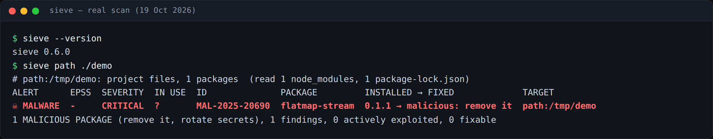

# casareanderson/tap

A Homebrew tap for Casareanderson tools, currently serving one formula: sieve, a purpose-built CVE scanner for Linux hosts and containers that ranks findings by CISA KEV and EPSS.



[](https://github.com/casareanderson/sieve/actions/workflows/ci.yml)
[](LICENSE)

Sieve reads package lists already on the box, asks [OSV.dev](https://osv.dev) which advisories affect those exact versions, and ranks results by CISA KEV and EPSS — its only dependency is `requests`. No scanner binary, no 1.4 GB database: sieve queries public APIs on your host (OSV.dev, CISA KEV, EPSS).

## What it does

Sieve scans packages without downloading a large local database:
- Reads package lists from dpkg, apk or rpm metadata plus Python and npm packages outside the OS; then scans running containers through their filesystem in `/proc`.
- Queries OSV.dev for advisories affecting each version; ranks them by CISA known-exploited (KEV) and EPSS likelihood, with malware first.
- Flags per finding whether vulnerable code is loaded right now (`IN USE`) and checks no installed file changed since installation (verify).
- Scans project directories from lockfiles without running npm, yarn, pip or node — only reads `package-lock.json`, `yarn.lock`, `requirements*.txt`, `poetry.lock`, etc.
- Finds default passwords on boards like ESPHome and WLED, plus plain-text secrets in files, shell histories, AI chats and container environments.

Sieve is purpose-built: it does not run npm/pip/node/yarn; that saves 15 MB of interpreter time and 0.3 seconds per `npm view` call. Read more at [How sieve works](https://github.com/casareanderson/sieve#how-it-works).

## Quick start / Install

Requires Python 3.10 or newer (`python3 -m sieve host`) or Homebrew (macOS/Linux, same PyPI release). The tap is distribution-only; the scanner itself lives in [`sieve`](https://github.com/casareanderson/sieve).

```bash
pipx install sieve-scan==0.6.0  # or brew install casareanderson/tap/sieve on macOS/Linux (same release)
sieve host --limit 3
```

Success prints a ranked table and one-line summary; exits `1` on known-malicious findings:

```console
$ sieve host --limit 3

ALERT  EPSS  SEVERITY  ID              PACKAGE         INSTALLED → FIXED   TARGET
       73.3%  UNKNOWN   CVE-2011-3389   gnutls-bin      3.8.9-3+deb13u4 → … host

1965 findings, 0 actively exploited, 0 fixable
```

Docker scans mount `/` read-only and pipe the collector output:

```bash
docker run --rm -v /:/host:ro ghcr.io/casareanderson/sieve host --root /host
```

Full setup, tested every week on a fresh machine: [docs/SETUP.md](https://github.com/casareanderson/sieve/blob/main/docs/SETUP.md). A daily job that prints 200 findings every morning can be reduced via `--limit 50` or `--new`, which shows only changes since the last run.

## Usage

Install sieve and use these commands (full reference in [`sieve README`](https://github.com/casareanderson/sieve)) :

- `sieve host` — this machine: dpkg, apk or rpm packages, Python `pip` outside the OS, global npm
- `sieve containers` — every running Docker container on this machine (needs root)
- `sieve path DIR …` — project directories from lockfiles (node_modules, requirements.txt, virtualenvs)
- `sieve verify` — has any installed file been tampered with?
- `sieve remote user@host` — scan another machine over SSH (no install there)
- `sieve sbom FILE …` — read CycloneDX or SPDX JSON from other tools
- `sieve devices [HOST …]` — ESPHome, WLED and Victron Venus OS boards on the network
- `sieve secrets [DIR …]` — plain-text credentials in files, shell histories, chat logs, container environments

Common options:

| option | effect | default |
|---|---|---|
| `--json` | machine-readable output | none |
| `--sarif` | SARIF 2.1.0 for GitHub code scanning | none |
| `--sbom cyclonedx\|spdx` | print SBOM instead of scanning | none |
| `--with-vulns` | add findings to SBOM when used with `--sbom cyclonedx` | false |
| `--min-severity low\|medium\|high\|critical` | hide findings below this severity | all |
| `--cache PATH` | advisory cache path | `$HOME/.cache/sieve/sieve.db` |
| `--no-epss` | don't download/use EPSS scores | enabled |
| `--kernel` | also check kernel packages (skipped by default) | skipped |
| `--root PATH` | read host packages from this directory instead of `/` | `/` |
| `--new` | only findings new since last same-scan run, plus what's gone | none |
| `--baseline FILE` | when used with `--new`, where to save/restore the last run | next to cache |
| `--limit N` | table rows to print | 50 (or 0 for all) |
| `--depth N` | how deep to look under each directory in paths | 8 |

`sieve diff OLD.json NEW.json` prints new/old findings plus exit `1` on a known-exploited or malicious change.

## How it works / Architecture

Sieve scans without a local database and with minimal dependencies:
- Reads package databases (`dpkg`, `apk` or `rpm` headers), pip outside the OS, global npm, then project lockfiles (no node/npm/pip/yarn to run).
- Queries public APIs [OSV.dev](https://osv.dev) for advisories, [CISA KEV](https://www.cisa.gov/known-exploited-vulnerabilities-catalog) and [EPSS (FIRST)](https://www.first.org/epss/) for exploitation likelihood, then ranks malware first.
- For `--in-use-only`, reads `/proc/[pid]/maps` and `/proc/[pid]/rootfs` to see which vulnerable code is loaded in running processes; native code only — pure-Python, npm and Go packages are always marked unknown.
- On Docker mounts: package lists are world-readable so scanners run as unprivileged users on the host; running containers themselves need root and `/proc/[pid]/rootfs` reads.

See [How sieve works](https://github.com/casareanderson/sieve#how-it-works) for architecture details.

## Status and limits / Results

Sieve works best on Debian/Ubuntu (dpkg); other platforms may still query OSV.dev but `verify` uses `/var/lib/dpkg/info/<pkg>.md5sums` only there. Kernel packages are skipped by default to reduce API load; enable with `--kernel`. The advisory cache (KEV and EPSS) is ~5 MB and cached locally or via `-v sieve-cache:/home/sieve/.cache` on Docker.

| system | what is scanned | notes |
|---|---|---|
| Debian, Ubuntu | dpkg package metadata and checksums from `.md5sums` | `verify` uses MD5; other packages are read but not verified for tampering |
| Alpine Linux | apk database (SHA-1) | supported via the official scanner image |
| rpm-based (AlmaRocky RHEL openSUSE) | rpmdb headers | supported in the upstream scanner; this tap's formula assumes dpkg-only on Linux |
| Go binaries pre-Go 1.18 | only names from `lib/` or `/app/` | counted; may not be fully read if they use internal build info |

`sieve verify`:
- Can't check npm (npm keeps no per-file hashes).
- Cannot tell root vs unprivileged when swapping binaries on the same machine.
- Read-only host filesystems work but require mounting and reading `/proc/[pid]/rootfs` for containers.

## Configuration

| configuration | effect | default |
|---|---|---|
| `XDG_CACHE_HOME` | advisory cache path (KEV + EPSS) | `$HOME/.cache/sieve/` |

Set `XDG_CACHE_HOME=~/sieve-cache` to persist the cache across container restarts, or add `-v sieve-cache:/home/sieve/.cache` on Docker to make it writable and persistent. The scanner only transmits package names and versions to OSV.dev; nothing else about a host is sent out.

## Licence and credits

sieve ships with AGPL-3.0. For full details, dependencies and data sources see [Licence and credits](https://github.com/casareanderson/sieve#licence-and-credits). Sieve started inside [`warden`](https://github.com/casareanderson/warden); that home lab server was decommissioned on 10 October 2026 in favour of [ephor](https://github.com/casareanderson/ephor) — the dependency-free alternative for scanning small homelab devices without external API calls.

## The warden family

Three tools under one console: [warden](https://github.com/casareanderson/warden), **sieve** (this tap), and [ephor](https://github.com/casareanderson/ephor) for homelab scanning. Warden was decommissioned on 10 October 2026; its roles now filled by ephor.

```